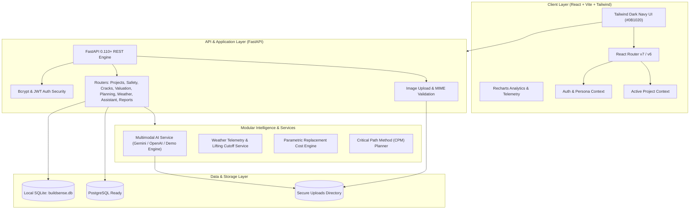

# BuildSense AI — Architecture & Technical Specifications

## 1. System Overview

**BuildSense AI** is a multimodal construction intelligence web platform designed for general contractors, structural engineers, quantity surveyors, and safety officers. The platform provides unified AI visual hazard detection, forensic crack observation, automated CPM project planning, parametric real estate replacement valuation, and weather-aware operational advisories.

---

## 2. Modular AI Service Layer & Fallback

The multimodal AI service is designed with strict separation between configuration, live external API adapters, and fallback simulation:

1. **Provider Resolution**: Inspects `GEMINI_API_KEY` and `OPENAI_API_KEY`. If configured, dispatches image buffers and structured schema prompts.
2. **Strict JSON Schema Contracts**: All outputs are parsed directly into Pydantic models (`SafetyAnalysisData`, `CrackAnalysisData`, `PlanData`).
3. **No Silent Mocking**: Per section 16, if external AI credentials fail during a live request, the engine throws an explicit error rather than silently masking it as demo. When no keys are provided, it operates in an explicitly labeled `"mode": "demo"` mode.
4. **Mandatory Safety & Forensic Disclaimers**: Disclaimers are embedded in both backend responses and frontend UI banners.

---

## 3. Database Models & Schema Design

- **Users**: Identity, bcrypt hashed password, and role (`Administrator`, `Project Manager`, `Site Engineer`, `Safety Officer`).
- **Projects**: Core commercial records with budget tracking, status, EVM completion percentage, and manager assignment.
- **Tasks & Milestones**: Work breakdown schedule items with priority, assignee, dependencies, and due dates.
- **Safety Inspections**: Stored photographic inspections, categorized hazard findings, severity tags, and limitations.
- **Crack Inspections**: Structural masonry/concrete photographic audits with structure type, location notes, and tell-tale gauge recommendations.
- **Property Valuations**: Parametric replacement valuations with architectural quality indexes, condition adjustments, and depreciation curves.
- **Daily Reports**: Daily site logs with headcount, heavy equipment logs, bulk materials, deliveries, and delay logs.
- **Chat Messages**: Persistent AI conversation records with session IDs and project context linkage.
